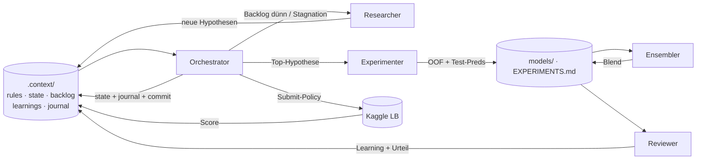

# .agents – agentisches Kaggle-Trainingssystem

Tool-unabhängige Definitionen (Markdown mit YAML-Frontmatter) für einen Loop, der Training
automatisiert und mit jedem Zyklus dazulernt. Funktioniert mit jedem Agenten, der Dateien lesen
und Shell-Befehle ausführen kann; für Claude Code gibt es `setup_claude.sh`.

## Aufbau
```
.agents/
├── agents/                 # Rollen
│   ├── orchestrator.md     # steuert einen Zyklus, entscheidet, schreibt den Stand zurück
│   ├── researcher.md       # neue Hypothesen aus Learnings + Fehler-/Datenanalyse → Backlog
│   ├── experimenter.md     # setzt genau eine Hypothese als Experiment um, führt CV aus
│   ├── reviewer.md         # Leakage-/Signifikanz-Check → Learning + Backlog-Status
│   └── ensembler.md        # Rank-Blend + Hill Climbing, Submission-Empfehlung
├── skills/                 # wiederverwendbare Arbeitsanleitungen
│   ├── kaggle-autopilot/   # Einstieg: ein Zyklus (Orchestrator), mit /loop dauerhaft
│   ├── kaggle-data/        # Daten laden & prüfen
│   ├── kaggle-experiment/  # Experiment anlegen & laufen lassen
│   ├── kaggle-blend/       # Ensembling
│   ├── kaggle-submit/      # Validieren, einreichen, LB loggen
│   └── kaggle-new-competition/  # neuen Competition-Ordner nach Konvention aufsetzen
└── setup_claude.sh         # macht agents/ + skills/ für Claude Code sichtbar (Symlinks in .claude/)
```

## Der Loop


**Warum es besser wird:** Wissen liegt nicht im Modell-Gedächtnis, sondern in `.context/`.
Der Reviewer schreibt nur geprüfte Erkenntnisse (mit Δ-AUC) nach `learnings.md`, der Researcher
baut darauf neue Hypothesen und vermeidet Wiederholungen, und der Orchestrator priorisiert
nach erwartetem Gewinn, Kosten und Restzeit.

## Konvention je Competition-Ordner
Jeder Ordner mit `.context/` ist eine Competition und bietet dieselbe Schnittstelle:
`src/{config,data,features,cv,models,tracking,blend,status,kaggle_api}.py`,
`experiments/_template/run.py`, `EXPERIMENTS.md`. Referenz: `Fraud_Detection_Playground_S6E11/`.

## Starten
```bash
./.agents/setup_claude.sh        # einmal pro Clone (nur für Claude Code)
```
Dann in Claude Code: `/kaggle-autopilot` (ein Zyklus) oder `/loop /kaggle-autopilot` (Dauerbetrieb).
Andere Agenten: `.agents/agents/orchestrator.md` als Aufgabe geben.

## Sicherheitsgurte
- Autonomie steuert der Mensch in `<COMP>/.context/rules.md` (`auto_submit`, Budgets, `min_delta_auc`).
- Standard: Submissions nur nach Rückfrage, ein Trainingsjob gleichzeitig, nie Daten committen.
