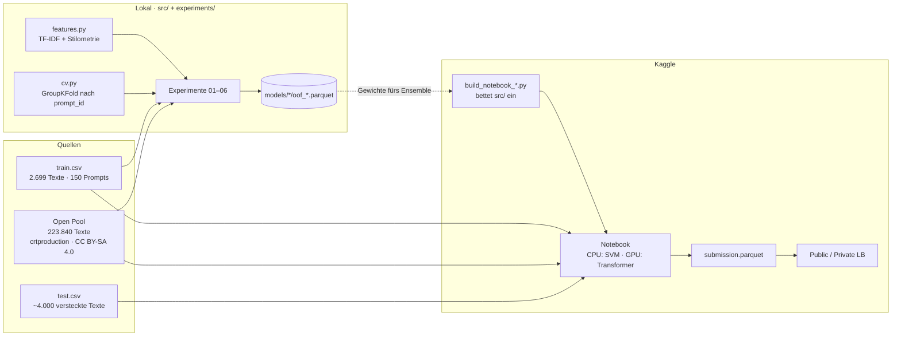
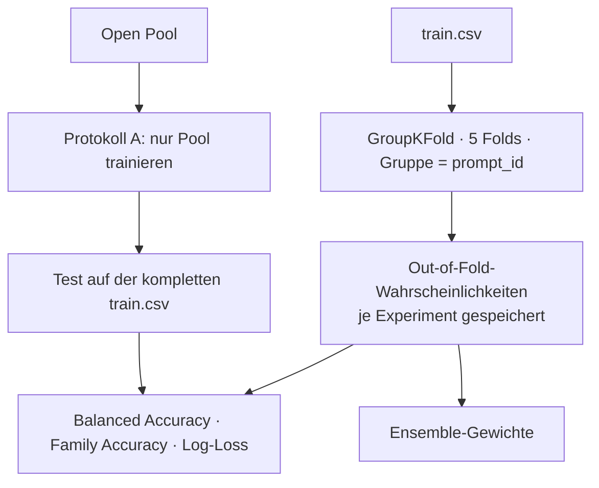
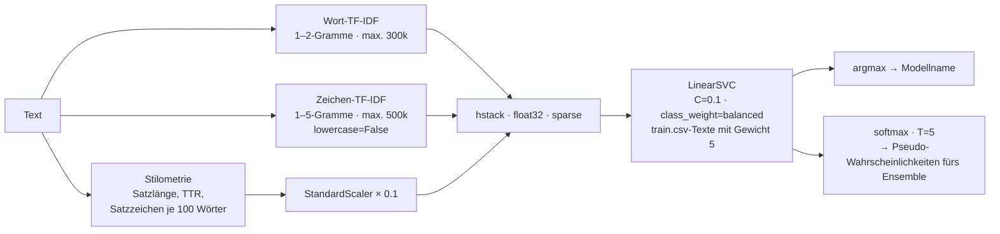
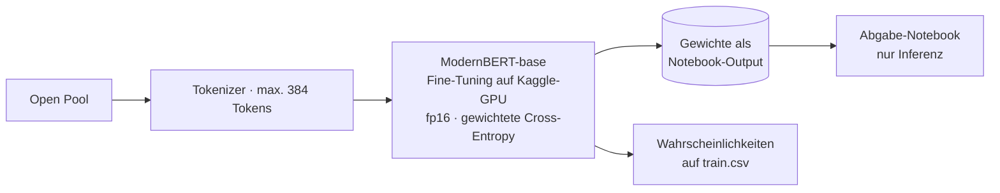
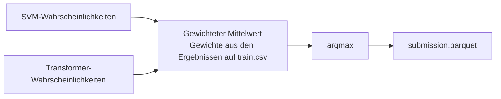

# Architektur & Datenfluss

Lösung für die Kaggle-Competition [Name That LLM](https://www.kaggle.com/competitions/name-that-llm). Die Aufgabe: Für einen Text vorhersagen, welches von 18 LLMs ihn geschrieben hat. Bewertet wird mit **Balanced Accuracy**, also dem Mittelwert der Recalls über alle 18 Klassen.

## Überblick

Lokal (auf dem Mac) laufen schnelle Experimente mit gemeinsamer Validierung. Auf Kaggle laufen das große Training und die Abgabe. Dort gibt es kein Internet, das Modell muss also im Notebook trainiert werden oder als Input eingebunden sein.



## Validierung

Fast jeder Prompt wurde von allen 18 Modellen beantwortet. Wäre derselbe Prompt in Training und Validierung, würde das Modell am Thema statt am Stil lernen. Deshalb sind die Folds nach `prompt_id` gruppiert.



- **Protokoll A** (nur Pool trainieren, auf der echten train.csv testen): misst, wie gut sich das Gelernte auf echte Wettbewerbstexte überträgt.
- **Protokoll B** (Pool + train.csv-Folds): misst, wie viel die echten Texte zusätzlich bringen und wie stark man sie gewichten sollte.

## Modell 1: LinearSVC auf TF-IDF (aktuelle Abgabe)



Warum diese Merkmale:

- **Typografie trennt die Familien.** Claude, GLM und Kimi verwenden den Gedankenstrich „—“. GPT, Gemini, Qwen und Kimi verwenden das typografische Apostroph ’. Deshalb bleiben Groß-/Kleinschreibung und Sonderzeichen erhalten.
- **Die Stilometrie wird schwach gewichtet (× 0.1).** Die Genauigkeit bleibt gleich, aber der SVM konvergiert etwa 20-mal schneller als mit voller Gewichtung.
- Code: [`src/features.py`](src/features.py) und [`src/linear_large.py`](src/linear_large.py). Das Notebook baut [`kaggle/build_notebook_svm.py`](kaggle/build_notebook_svm.py).

## Modell 2: ModernBERT auf dem Pool (in Arbeit)



Das Training läuft in einem eigenen Notebook mit Internet, weil es ModernBERT von Hugging Face lädt. Das Abgabe-Notebook bindet dessen Output als Input ein und läuft ohne Internet. Code: [`kaggle/build_notebook_bert.py`](kaggle/build_notebook_bert.py).

## Ensemble (geplant)



TF-IDF erkennt Typografie und Wortwahl, der Transformer eher Stil und Struktur. Mit 3.000 Pool-Texten pro Modell, getestet auf train.csv:

- SVM allein: 0.449
- ModernBERT allein: 0.479
- Mischung: 0.508–0.509

Die Mischung ist robust: Der Wert gilt für viele Kombinationen, etwa Softmax-Temperatur 5 mit SVM-Gewicht 0.4–0.6 oder Temperatur 10 mit SVM-Gewicht 0.3–0.4.

Nach dem Mischen gleicht ein **Sinkhorn-Ausgleich** (Stärke 0.6) die vorhergesagten Klassenanteile an. In einer Simulation auf train.csv brachte er +1,3 Punkte bei ausgewogenem Test und +0,8 bei stark unausgewogenem. Bei einem Modell, das nach Stufe 2 auf der ausgewogenen train.csv trainiert ist, ist der Gewinn kleiner. Das Abgabe-Notebook baut [`kaggle/build_notebook_ensemble.py`](kaggle/build_notebook_ensemble.py).

## Ergebnisse

| Ansatz | Trainingsdaten | Balanced Accuracy | Public LB |
|---|---|---|---|
| TF-IDF + LogReg + Stilometrie | train.csv | 0.352 (CV) | 0.320 |
| Hierarchisch (Familie → Modell) | train.csv | 0.351 (CV) | – |
| ModernBERT-base | train.csv, Fold 0 | 0.357 | – |
| LinearSVC | Pool, 1.000 / Modell | 0.400 (Protokoll A) | – |
| LinearSVC | Pool, 3.000 / Modell | 0.449 (Protokoll A) | – |
| ModernBERT-base, 2 Epochen | Pool, 3.000 / Modell | 0.479 (Protokoll A) | – |
| Mischung SVM + ModernBERT (T=5, 50/50) | Pool, 3.000 / Modell | 0.508 (Protokoll A) | – |
| ModernBERT Stufe 1 + Stufe 2 (2 Epochen train.csv) | Pool 3.000 / Modell, dann train.csv | 0.518 (5-Fold-OOF) | – |
| Mischung SVM + ModernBERT Stufe 2 (T=5, 50/50) | wie oben | 0.530 (OOF) | – |
| LinearSVC | Pool, 6.000 / Modell | 0.489 (Protokoll A) | – |
| **LinearSVC** | **kompletter Pool + train.csv** | – | **0.470** |

## Ordnerstruktur

```
Name_That_LLM_2026/
├── src/                  gemeinsamer Code (Daten, Features, CV, Modelle)
├── experiments/          ein Ordner je Ansatz, mit README und Skripten
│   ├── 01_tfidf_linear/
│   ├── 02_stylometry/
│   ├── 03_hierarchical/
│   ├── 04_transformer/   ModernBERT lokal (MPS)
│   ├── 05_ensemble/
│   └── 06_external_data/ Open Pool: Skalierung & Kombination
├── kaggle/               Notebook-Generatoren (build_notebook_*.py) + Kaggle-Metadaten
│   ├── svm_pool/         Abgabe: LinearSVC (CPU, offline)
│   ├── svm_oof/          OOF der SVM auf train.csv (CPU) für Ensemble-Gewichte
│   ├── bert_pool/        Training Stufe 1: ModernBERT auf dem Pool (GPU)
│   ├── bert_stage2/      Training Stufe 2: Feintuning auf train.csv + CV (GPU)
│   ├── lora/             LoRA auf Qwen3 (4B/8B), zweistufig, eigene LoRA-Schicht ohne peft (GPU)
│   └── ensemble/         Abgabe: SVM + ModernBERT Stufe 2 + Sinkhorn (GPU, offline)
├── notebooks/01_EDA.ipynb
├── data/                 nicht im Git (download_data.sh)
└── models/               OOF-Vorhersagen, nicht im Git
```
